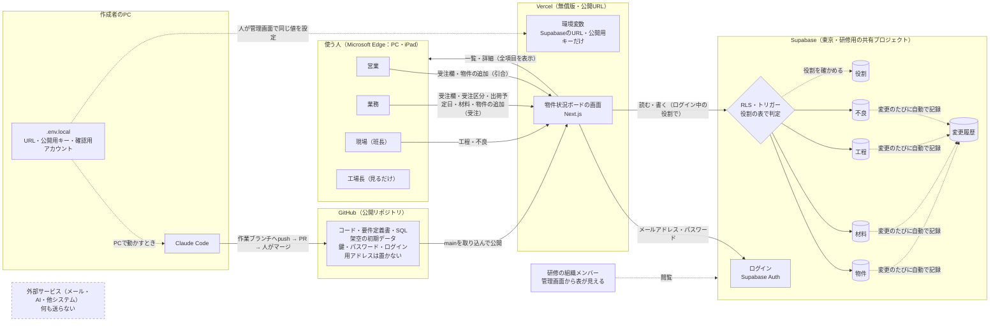

# 物件状況ボード（架空データの試作）要件定義書 第2版

- 版：第2版（2026-10-21）。第1版（設計ワークで作成）と単一HTML版の試作を土台に、GitHub → Supabase → Vercel の3段階で作り直すための版
- 位置づけ：ある製造現場の物件管理を想定した、架空データだけの学習用の試作
- データ：すべて架空。実在の会社名・客先名・品番・図面・単価・金額・個人名・個人のメールアドレスは入れない
- このリポジトリは公開（誰でも読める）。鍵・パスワード・ログインに使うメールアドレスの値は、この文書にもコードにも書かない（置き場所だけ書く）
- 2026-10-21 決定：出荷予定日を書けるのは業務だけ／ログイン用アカウントは役割別4つ＋役割なしの確認用1つ／研修用の共有プロジェクトに置く

---

## 0. 位置づけ

### 0.1 要望・要求・要件
- 要望の原文と経緯は作成者の作業メモに保管し、このリポジトリには載せない
- 要求：物件ごとの受注・材料・工程・不良の状況を4つの役割が同じ1画面で見られ、電話や口頭で確かめなくても「今どうなっているか・いつ出るか」が分かること。書ける欄の制限をデータベースで守ったまま、URLで使える形にすること

| 役割 | 要望（想定） | 要求 | 要件（確かめられる形） |
|---|---|---|---|
| 営業 | 納期をすぐ答えたい | 客先に聞かれたその場で、現場へ電話せずに答えたい | 一覧のカードに状態・残り日数・出荷予定日が出る。担当班・状態で絞れる |
| 業務 | 材料が間に合うか知りたい | 材料の遅れを、現場から言われる前に見つけたい | 「材料待ち」で絞れる。材料ごとに入荷予定日と入荷済みが見え、入荷済みにすると状態が変わる |
| 現場 | 材料がいつ入るか知りたい | 朝の段取りで、材料が揃った物件を納期の近い順に知りたい | 一覧は納期の近い順。工程の完了は2タップ。iPadのEdgeで読める |
| 工場長 | 全体を見たい | 遅れ・材料待ち・不良を会議の前に把握したい | 上部に状態ごとの件数・納期注意・不良あり・班ごとの進行中の件数が出る |

### 0.2 進め方（3段階）
| 段階 | 作るもの | データの置き場 | 役割の決め方 | 公開 |
|---|---|---|---|---|
| 1 GitHub | Next.js（App Router）＋ shadcn/ui で全画面。作業ブランチ → PR → マージ | 架空20件をコードに持ち、変更はそのPCのEdgeの中に保存（単一HTML版と同じ） | 画面上部の切り替えボタン | しない（PCで動かす） |
| 2 Supabase | 表・RLS・トリガー・権限・初期データのSQL、ログイン | Supabase（`app_user01_` で始まる表） | 役割別のログイン用アカウント4つ | しない（PCで動かす） |
| 3 Vercel | 公開の設定 | 同上 | 同上 | 会社のメールアドレスで登録した無償版（Hobby）。試作・検証・学習目的に限る |

### 0.3 段階（Lv）と作るか使うか
- Lv0（学習用の試作）：止まっても業務で困る人はいない。ただし README と CLAUDE.md を置き、DB側の権限（§5）は作った人とは別の確認役が §8 の条件で確かめる
- 作るか使うか：画面と状態の規則は小さく作る（学習が目的）。ログインは Supabase Auth を使う（自作しない）。保存と権限は Supabase のDB（RLS）を使う。業務で使う版はこの試作の範囲外とし、会社の正式な環境で改めて判断する

---

## 1. 目的・困りごと

**物件ごとの受注・材料・工程・不良を、営業・業務・現場・工場長が同じ1画面で見られるようにし、電話や口頭での確認を減らす。**

困りごと（想定）
- 営業：客先に納期を聞かれると、現場へ電話して確かめないと答えられない
- 業務：材料は発注したが、現場が納期に間に合うかが分からない
- 現場：材料がいつ入るか・揃ったかが分からない。不良で部材が足りなくなっても、伝わるのが遅れる
- 状況のやりとりが口頭・電話・各班の表計算ファイルに分かれ、あとから見返せない

解決した状態：電話をかけなくても、誰でも物件の状態（遅れ／材料待ち／進行中／引合／出荷済み）と出荷予定日が分かる。誰が・いつ・何を変えたかを後から見返せる。

学習としての目的：要件定義 → 画面 → DB（ログインと権限）→ 公開の順に、鍵とデータを守りながら作る手順を身につける。

---

## 2. 使う人

| 役割 | 入れること | 見たいこと | 端末 | 使う場面 |
|---|---|---|---|---|
| 営業 | 物件の追加（引合）、受注欄（品名・客先・数量・重量・希望納期・担当班） | 進み具合と出荷予定日 | PC | 客先から納期を聞かれたとき |
| 業務 | 物件の追加（受注）、受注区分、出荷予定日、材料（発注日・入荷予定日・入荷済み） | 材料待ち・遅れそうな物件 | PC | 受注時・材料の入荷時・朝の確認 |
| 現場（班長） | 工程の開始・完了、不良の数とひとこと | 材料が揃った物件を納期の近い順に | iPad | 朝の段取り・工程が終わったとき |
| 工場長 | （入れない） | 遅れ・材料待ち・納期注意・不良ありの件数、班ごとの進行中 | PC | 週の始め・会議の前 |

- ログイン用アカウントは役割ごとに1つ（第2段階から）と、役割を登録しない確認用1つ。個人ごとのアカウントは作らない。メールアドレスは個人を特定しない架空のもの
- ペルソナ（架空）
  - 現場の班長：手袋のまま触ることがある。朝に班員へ段取りを伝える → 開いてすぐ納期順、完了は大きなボタン1つ、不良は数とひとことだけ
  - 営業：1日に数件、客先から「いつ出る？」と聞かれる → 状態と出荷予定日が一目で分かること。工程の細かい入力は要らない

---

## 3. 画面とできること

### 3.1 画面の一覧
| # | 画面 | 使う人 | できること | 段階 |
|---|---|---|---|---|
| 1 | ログイン | 全員 | メールアドレスとパスワードで入る。ログアウト。新規登録・パスワード再設定の入口は置かない | 2〜 |
| 2 | 一覧 | 全員 | 件数・絞り込み・カード（§3.2） | 1〜 |
| 3 | 詳細（一覧の上に重ねて開く） | 全員 | 受注・材料・工程・不良・変更履歴（§3.3） | 1〜 |
| 4 | 物件の追加（同上） | 営業・業務 | §3.4 | 1〜 |

画面の上部：第1段階は役割の切り替えボタン（営業・業務・現場・工場長）。第2段階からはボタンを外し、ログイン中の役割名とログアウトを出す。役割を変えたいときは、ログアウトして別のアカウントで入る。

### 3.2 一覧
- 上部の件数（押すと絞り込み）：すべて／遅れ／材料待ち／進行中／引合／出荷済み／納期注意／不良あり（不良ありは他の絞り込みと組み合わせられる）
- 班ごとの進行中の件数（A班・B班・C班）
- 担当班での絞り込みと表示件数
- 並び：希望納期の近い順
- カードの中身
  - 左端の色と状態の文字
  - 物件番号・担当班・品名・客先（架空）・希望納期
  - 右上に残り日数（「N日後が納期」「N日超過」「出荷済み」）
  - 目印（納期注意・不良あり）
  - 4工程のランプ（完了＝塗りつぶし、作業中＝太枠）
  - 現在の工程・材料の入荷数（入荷済み/全数）・不良の数・出荷予定日
- 「物件を追加」ボタン：営業・業務だけに出す
- 条件に合う物件が無いときは「絞り込みを『すべて』に戻してください」と出す
- 第2段階から「最新にする」ボタンを置く（他の人の変更は再読み込みで反映）
- 画面の足元：「架空のデータだけを入れてください」と保存先を出す（第1段階＝このPCのEdgeの中／第2段階＝研修用のデータベース）

### 3.3 詳細
- 見出し：物件番号・役割・品名・状態・目印・閉じる（Escキーでも閉じる。入力中の欄は確定してから閉じる）
- 受注欄：品名・客先（架空）・数量・重量(kg)・希望納期・出荷予定日・担当班・受注区分
- 材料欄：部材名・発注日・入荷予定日・入荷済み。部材の追加・削除（削除は確認つき）
- 工程・不良欄：4工程（切断 → 溶接 → めっき手配 → 出荷）の状態（未着手／作業中／完了）・開始日・完了日と、「開始」「完了」ボタン
  - 作業中にすると、開始日が空なら今日を入れる
  - 完了にすると、空の開始日・完了日に今日を入れる
  - 未着手に戻すと日付を消す
  - 不良：工程・数（1以上）・ひとことで登録する。削除は確認つき。変更はできないので、直すときは削除して登録し直す
- 書ける役割にだけ入力欄を出す。それ以外は表示だけにして「○○だけが書けます」と出す（§5）
- 変更履歴：日時・役割・欄・変更前 → 変更後を新しい順に出す
- 物件の削除：営業・業務だけ。「元に戻せません」と確認してから削除し、履歴に残す
- DBに拒否されたとき（第2段階から）：理由を画面に出し（例「この欄は業務だけが書けます」）、表示を保存前の値に戻す。黙って失敗しない

### 3.4 物件の追加
- 入れる項目：品名（必須）・客先（架空）・数量・重量(kg)・希望納期（必須）・担当班
- 受注区分は役割で決まる：営業＝引合、業務＝受注。第2段階からはDBが決め、画面から送られた値は使わない
- 物件番号は自動（P-101〜の連番。削除した番号も使い回さない）。4工程は未着手で自動で作る
- 追加したら、その物件の詳細を開く

### 3.5 状態の決め方
状態は手で選ばせず、入力内容から毎回計算する（保存しない）。上から順に確かめ、最初に当てはまったものにする。

1. 出荷済み（グレー）：工程「出荷」が完了している
2. 引合（白）：受注区分が引合
3. 遅れ（赤）：希望納期 ＜ 今日
4. 材料待ち（黄）：入荷済みでない材料が1つ以上ある
5. 進行中（青）：上のどれでもない（材料が0件の受注物件も進行中）

### 3.6 目印と表示の決め方
- 納期注意：状態が材料待ち・進行中で、希望納期まで0〜N日（N＝第1段階は画面の足元で1〜60日に変えられる・初期7日／第2段階からは7日で固定）
- 不良あり：出荷済みでなく、不良の数の合計が1以上
- 現在の工程：完了していない最初の工程（すべて完了なら「—」）
- 残り日数：希望納期 − 今日
- 「今日」はすべて日本時間で数える（§6）

### 3.7 段階による違い
| 項目 | 第1段階（GitHub） | 第2段階から（Supabase・Vercel） |
|---|---|---|
| 役割 | 画面上部の切り替え（誤操作を防ぐためのもの。なりすましは防げない） | ログインしたアカウントの役割 |
| データ | コードの中の架空20件 | Supabaseの表（コードからは架空データを外す） |
| 保存 | そのPCのEdgeの中（閲覧データを消すと消える） | DBに保存する。別の端末でも同じ内容 |
| 書ける欄の制限 | 画面だけ | 画面＋DB |
| 変更履歴を書くもの | 画面のコード | DBのトリガー |
| 初期データに戻す | 画面の足元のボタン（確認つき） | ボタンは外し、初期データSQLを人が SQL Editor で実行 |
| 納期注意の日数 | 画面の足元で変えられる（そのPCだけ） | 7日で固定 |

---

## 4. 扱うデータ（すべて架空）

### 4.1 表（第2段階から）
表・関数・トリガー・ポリシーの名前は、すべて `app_user01_` で始める（研修用の共有プロジェクトで、他の受講者とぶつからないようにするため）。

| 表 | 中身 | 主な列（制約） |
|---|---|---|
| app_user01_properties | 物件（受注欄） | 物件番号（P-101 から自動の連番。変更不可・欠番を再利用しない）／品名（必須・50字以内）／客先（架空・30字以内）／数量（0以上の整数）／重量kg（0以上）／希望納期（必須）／出荷予定日（空でよい）／担当班（A班・B班・C班）／受注区分（引合・受注）／作成日時・更新日時 |
| app_user01_materials | 材料 | 物件／部材名（必須・30字以内）／発注日／入荷予定日／入荷済み（はい・いいえ） |
| app_user01_processes | 工程（1物件に4行） | 物件／順番（1〜4）／工程名（切断・溶接・めっき手配・出荷）／状態（未着手・作業中・完了）／開始日／完了日。物件の追加時にDBが4行作る |
| app_user01_defects | 不良 | 物件／工程（4工程のどれか）／数（1以上の整数）／ひとこと（100字以内）／登録日 |
| app_user01_history | 変更履歴 | 日時／役割／物件番号／欄／変更前／変更後。DBのトリガーだけが書く。物件を削除しても残る |
| app_user01_roles | 役割 | ログイン用アカウント（Supabase Auth の利用者ID）／役割（営業・業務・現場・工場長）。人が SQL Editor で登録する |

- 材料・工程・不良は、物件を削除すると一緒に消える
- 状態・納期注意・現在の工程は保存しない（§3.5・§3.6）
- 役割の無い操作（SQL Editor など）による変更は、履歴の役割を「管理」と記録する。初期データSQLは最後に履歴を空にする

### 4.2 初期データ
- 架空の20件（P-101〜P-120）。中身は単一HTML版の試作と同じ
- 日付は「今日」からの相対日で持つ。第1段階は初めて画面を開いた日（または「初期データに戻す」を押した日）、第2段階は初期データSQLを流した日が基準になる。そのため件数の確認（§8 #1）は、基準の日と同じ日に行う
- 例（6件）

| 物件番号 | 品名 | 客先 | 班 | 希望納期 | 材料（入荷/全数） | 工程 | 不良 | 期待する状態・目印 |
|---|---|---|---|---|---|---|---|---|
| P-101 | 架台フレーム | A社（架空） | A班 | 今日−6日 | 2/2 | 4工程すべて完了 | 0 | 出荷済み |
| P-103 | 配管サポート | C社（架空） | C班 | 今日−2日 | 2/2 | 切断・溶接は完了、めっき手配が作業中 | 3 | 遅れ・不良あり |
| P-104 | 手すりユニット | D社（架空） | A班 | 今日−1日 | 1/2 | 切断が完了 | 0 | 遅れ |
| P-106 | 階段ステップ | F社（架空） | C班 | 今日＋5日 | 1/2 | すべて未着手 | 0 | 材料待ち・納期注意 |
| P-108 | 機械カバー | H社（架空） | B班 | 今日＋3日 | 1/1 | 切断・溶接は完了、めっき手配が作業中 | 2 | 進行中・納期注意・不良あり |
| P-112 | 屋外架台 | I社（架空） | A班 | 今日＋40日 | 0/0 | すべて未着手 | 0 | 引合 |

- 20件全体の件数：すべて20／遅れ2／材料待ち5／進行中8／引合2／出荷済み3／納期注意4／不良あり4。班ごとの進行中は A班2・B班5・C班1

### 4.3 入れないもの
- 実在の会社名・客先名・品番・図面・単価・金額・個人名
- 個人のメールアドレス（ログイン用は役割ごとの架空アドレス）。変更履歴にも個人は記録せず、役割名だけを残す
- 画面の入力欄にも実データを入れない（足元に注意書きを出す）

---

## 5. 誰が何を見られるか

### 5.1 画面の上で
| 役割 | 一覧・詳細 | 受注欄 | 材料欄 | 工程・不良欄 | 物件の追加・削除 | 変更履歴 |
|---|---|---|---|---|---|---|
| 営業 | 見る | 書く（受注区分・出荷予定日を除く） | 見る | 見る | できる（引合で登録） | 見る |
| 業務 | 見る | 書く（すべて） | 書く | 見る | できる（受注で登録） | 見る |
| 現場 | 見る | 見る | 見る | 書く | — | 見る |
| 工場長 | 見る | 見る | 見る | 見る | — | 見る |
| ログインしていない人・役割の表に無いアカウント（第2段階から） | 何も見せない | | | | | |

- 金額を持たないので、役割で見せ分ける情報は無い。分けるのは書ける欄だけ
- 役割の表に無いアカウントでログインした場合は、「このアカウントには役割が登録されていません」とだけ出す

### 5.2 データベースで（表ごと・第2段階から）
「役割あり」＝ app_user01_roles に登録されたアカウント。

| 表 | 読む | 追加 | 変更 | 削除 |
|---|---|---|---|---|
| properties（物件） | 役割あり全員 | 営業（引合に固定・出荷予定日は空）・業務（受注に固定） | 営業：品名・客先・数量・重量・希望納期・担当班／業務：それに加えて受注区分・出荷予定日 | 営業・業務 |
| materials（材料） | 役割あり全員 | 業務 | 業務 | 業務 |
| processes（工程） | 役割あり全員 | DBのトリガーだけ（物件の追加時に4行） | 現場（状態・開始日・完了日だけ） | 物件の削除で一緒に消えるだけ |
| defects（不良） | 役割あり全員 | 現場 | なし | 現場 |
| history（変更履歴） | 役割あり全員 | DBのトリガーだけ | なし | なし |
| roles（役割） | 本人の行だけ | なし（人が SQL Editor で） | なし | なし |
| 未ログイン（anon） | すべての表で何もできない | | | |

### 5.3 守り方
- すべての表でRLSを有効にする。ポリシーは「ログインしているか」だけで判定せず、「役割の表に登録されているか・どの役割か」で判定する（共有プロジェクトには他の受講者のアカウントもあるため）
- 列ごとの制限はトリガーで止める
  - 受注区分・出荷予定日を変えられるのは業務だけ
  - 現場は工程名・順番・物件を変えられない
  - 物件番号・作成日時は誰も変えられない
  - 追加時の受注区分は役割で決まる
- 権限（grant）は明示する
  - anon には何も付けない（既定で付いている権限も外す）
  - authenticated には §5.2 で必要な操作だけを付ける
  - 2026-10-30以降に作る表は、付けないとアプリから読めない
- 役割を調べる関数・トリガーの関数は、検索パスを固定し、anon からは実行できないようにする
- アプリが使うキーは公開用（publishable）だけ。秘密キー（secret／service_role）はこのアプリでは使わず、PC・Vercel・GitHub のどこにも置かない
- 画面で入力欄を隠すのは使いやすさのため。守りはDBで行う
- 研修用の共有プロジェクトでは、管理画面に入れる組織のメンバーは、RLSに関係なく表を見たり変えたりできる。架空データだけを入れる理由の1つ

---

## 6. 非機能要件

| 項目 | この試作での要件 |
|---|---|
| 使いやすさ | Microsoft Edge（PC・iPad）で使う。状態は色と文字の両方で示す。主なボタンの高さは44px以上、本文は15px。現場が工程を「完了」にするまで2タップ（カード → 完了）。カードはキーボードでも開け、Escで閉じる |
| 性能 | 一覧が3秒以内に出る（20件）。保存して画面に反映されるまで2秒以内（目安）。1,000物件でも遅くならないよう、一覧のデータは表ごとにまとめて取り、物件ごとに問い合わせを繰り返さない |
| 可用性 | 試作のため停止の保証はしない。研修用の共有DBは7日使わないと一時停止し、再開は管理者だけができる。止まったら作成者へ連絡する（READMEに対処を書く） |
| セキュリティ | §5 のとおり。加えて次を守る：ログインは Supabase Auth に任せる（自作しない）／新規登録・パスワード再設定の画面は作らない／ログインしていないときは、サーバー側でもログイン画面へ回す／鍵・パスワードはコード・チャット・GitHub に書かない（置くのはPCの .env.local と、人が管理画面で設定するVercelの環境変数だけ）／名前が NEXT_PUBLIC_ で始まる値は、公開用のURLとキーだけ／表示はReactの標準の無害化に任せ、HTMLをそのまま差し込む書き方は使わない／DBへの問い合わせはSupabaseの部品で行い、SQLを文字でつなげない／見た目の部品は shadcn/ui の公式のものだけ／外部のフォント・アクセス解析・広告を読み込まない |
| 運用・保守 | 変更は作業ブランチ → PR → 人がマージ。main への直接push・強制push・履歴の書き換えはしない。DBの変更は supabase/ フォルダのSQLファイルで残し、人が中身を見て SQL Editor で実行する（AIはDBのデータや構造を変える操作を実行しない）。コミットの作者メールはGitHubの非公開用アドレスにする。保守は作成した部署が行う前提 |
| 移行 | 実データは取り込まない。第1段階のコード内の架空データは、第2段階で初期データSQLへ移し、コードからは外す（二重に持たない） |
| 日付と時刻 | 「今日」・残り日数・遅れの判定は日本時間（Asia/Tokyo）で行う。サーバー側で日付を扱うときも日本時間に直す。履歴の日時は日本時間で表示する |

---

## 7. 作らないもの
- 実データでの利用・業務の本番運用（無償版は試作・検証・学習に限る）
- 見積・帳票の印刷・在庫・単価・金額
- 他のシステムとの連携（基幹システム・ほかの業務アプリ）
- 通知・メールの自動送信（確認メール・パスワード再設定メールも使わない）
- 図面・写真・ファイルの添付
- 外部のAIサービスを呼び出す機能
- 個人ごとのアカウント、会社アカウントでのログイン（SSO）、新規登録画面、画面からのアカウント・役割の管理
- 同時編集の競合の検出、他の人の変更の自動反映（再読み込みで反映する）
- 第2段階から：「初期データに戻す」ボタン、納期注意の日数を画面で変える設定
- GitHub Actions などの自動実行、エラー監視サービス、独自ドメイン
- 次の版の候補（今回は作らない）：物件番号・品名での検索、役割ごとの初期表示、工場長向けのまとめ画面（班ごとの負荷・グラフ）、出荷予定日の自動計算

---

## 8. 完了の条件

「確かめる人」の AI は Claude Code。AIはログインが要る画面操作をせず、DBのデータを変える操作も実行しない。書き込みを伴う確認は、AIがスクリプトを作り、人が実行する。

| # | 段階 | 誰が・何をしたら | どうなればOK | 確かめる人 |
|---|---|---|---|---|
| 1 | GitHub | 誰でも、初期データの状態で一覧を開く | 上部が すべて20・遅れ2・材料待ち5・進行中8・引合2・出荷済み3・納期注意4・不良あり4、班ごとの進行中が A班2・B班5・C班1 になる | AI（Edgeの自動操作） |
| 2 | GitHub | 業務が、材料待ちの物件の未入荷の材料をすべて「入荷済み」にする | 現場に切り替えると、その物件が材料待ち（黄）から外れ、材料待ちの件数が1減る | AI |
| 3 | GitHub | 業務が出荷予定日を入れる | 営業に切り替えると、一覧のカードと詳細にその日付が出る | AI |
| 4 | GitHub | 現場が詳細を開く | 受注欄・材料欄は表示だけで入力欄が無く、「○○だけが書けます」と出る。工程・不良欄だけ入力できる。工場長ではどの欄も入力できない | AI |
| 5 | GitHub | 誰でも一覧を開く | 希望納期まで0〜7日で、状態が材料待ち・進行中の物件だけに「納期注意」が付く（出荷済み・引合・遅れには付かない） | AI |
| 6 | GitHub | 現場が不良（数1以上）を登録する | その物件に「不良あり」が付き、上部の不良ありの件数が増える。出荷済みの物件は数えない | AI |
| 7 | GitHub | 営業が物件を追加し、業務がその物件の受注区分を「受注」にする | 追加した直後は「引合（白）」。受注にすると引合から外れる | AI |
| 8 | GitHub | 現場が工程を「完了」にする | 「現在の工程」が次に進む。「出荷」を完了すると「出荷済み（グレー）」になる | AI |
| 9 | GitHub | どの役割でも、どれかの欄を変える | 詳細の変更履歴に、日時・役割・欄・変更前→変更後が新しい順で残る | AI |
| 10 | GitHub | 人がPCのEdgeで #1〜9 を触り、PRの変更を見る | AIの報告どおりに動く。コード・文書に社名・個人名・実データ・鍵が無い | 人 |
| 11 | Supabase | ログインしていない状態で画面を開く。公開用キーだけでAPIから各表を読む | 画面はログイン画面だけで、物件は1件も出ない。APIは0件か拒否になる | AI（読み取りだけ） |
| 12 | Supabase | 役割の表に無い確認用アカウントでログインする | 物件・材料・工程・不良・変更履歴が1件も読めず、「役割が登録されていません」とだけ出る | 人（画面）＋AIが作った読み取り確認スクリプトを人が実行 |
| 13 | Supabase | 現場のアカウントで、材料・受注欄の変更、物件の追加・削除をAPIへ直接送る | すべてDBに拒否され、値は変わらない | 人（AIが作った確認スクリプトを実行） |
| 14 | Supabase | 営業のアカウントで、工程・不良・受注区分・出荷予定日の変更と、受注区分を「受注」にした追加をAPIへ直接送る | 変更はすべて拒否される。追加は「引合」として登録され、出荷予定日は入らない | 人（同上） |
| 15 | Supabase | 工場長のアカウントでどの表にも追加・変更・削除を送る。どの役割でも、変更履歴の表へ直接書く・消す | すべて拒否され、値は変わらない | 人（同上） |
| 16 | Supabase | 業務がPCで材料を「入荷済み」にし、現場がiPadで画面を開き直す | 現場の画面でも黄から外れ、変更履歴に「業務」として残る。ブラウザを閉じて開き直しても内容が残る。初期データを流した当日に #1 の件数が同じになり、#2〜9 がログインした画面でも同じに動く | 人 |
| 17 | Vercel | 公開URLをPCとiPadのEdgeで開き、4役割と役割なしのアカウントでログインする | #11・12・16 と同じ結果になる。ログアウトすると何も見えなくなる | 人 |
| 18 | Vercel | 公開されている画面のファイルと、GitHubのリポジトリを調べる | 秘密キー・パスワード・.env.local の中身・ログイン用のメールアドレスが含まれない。社名・工場名・個人名・社内資料名が無い | AI |
| 19 | Vercel | 作業ブランチで小さな変更をし、PR → 人がマージする | 公開URLが自動で更新され、変更が出る | 人 |

---

## 9. データの流れ図

| 確かめる点 | この試作では |
|---|---|
| どこに保存されるか | 物件・材料・工程・不良・変更履歴・役割は、Supabase（東京）の app_user01_ の表だけ。PC・iPadのブラウザに残るのはログイン状態の記録だけ。鍵は作成者のPCの .env.local と Vercel の環境変数だけ（GitHubには置かない）。第1段階はそのPCのEdgeの中だけ |
| 誰に見えるか | 役割の表に登録された4アカウント：全項目を見られる（書けるのは役割ごと）。未ログイン・役割の無いアカウント：何も見えない。研修の組織メンバー：管理画面から表が見える。誰でも：GitHubのコードと架空の初期データ（鍵・パスワード・ログイン用のメールアドレスは置かない）、公開URLのログイン画面 |
| 外に出るデータは | なし。画面が通信するのは Vercel（画面の配信）と Supabase（ログインとデータ）だけ。メール・外部のAI・他のシステムへは送らない |

第1段階では Supabase と Vercel を使わない。架空データはコードの中にあり、画面はPC（localhost）でだけ動く。

---

## 10. 進め方と分担

| 段階 | AI（Claude Code） | 人 |
|---|---|---|
| 1 GitHub | 作業ブランチで画面を作る／localhost を Edge の自動操作で確かめる（#1〜9）／push／確かめたこと・確かめていないことを分けて報告する | 公開リポジトリを作る（研修資料の手順）／PCのEdgeで触る（#10）／PRを作り、中身を見てマージする |
| 2 Supabase | supabase/ に SQL を書く（表・RLS・トリガー・権限・初期データ・役割登録の雛形。実行はしない）／画面をDBとログインにつなぐ／確認スクリプトを作る（実行は人）／人の作業の手順書（HTML。値は書かない） | SQLの中身（表名・列・削除文・実データの有無）を見て SQL Editor で実行する／ログイン用アカウント5つを作り、4つを役割の表に登録する／.env.local に URL・公開用キー・確認用アカウントを入れる／確認スクリプトを実行する（#12〜15）／ログインして画面を確かめる（#12・16）／PRをマージする |
| 3 Vercel | 公開画面のファイルとリポジトリに、鍵・ログイン用アドレス・社名などが無いか確かめる（#18）／公開に失敗したらログから原因を調べて報告する（直す前に報告） | Vercelでリポジトリを取り込んでプロジェクトを作る（研修資料の手順）／環境変数を管理画面で設定して Deploy する／公開URLで4役割を確かめる（#17・19） |

- 確認スクリプトは .env.local から値を読み、値を画面やログに出さない。Claude Code は .env.local を読まない（`.claude/settings.json` の拒否設定で止める）
- 役割登録のSQLは雛形（メールアドレス欄は空欄）だけをリポジトリに置き、実際のアドレスは人が SQL Editor で入れる
- 確認で追加した物件は、スクリプトの最後で削除する（履歴には残る）

---

## 改訂履歴
- 第1版：設計ワークで作成（目的・使う人・画面・データ・権限・非機能・作らないもの・完了の条件）
- 第2版（2026-10-21）：単一HTML版の試作の仕様に合わせて書き直し、次を追加した：3段階の進め方、役割別ログイン、DBでの権限（RLS・トリガー・grant）、データの流れ図、AIと人の分担
